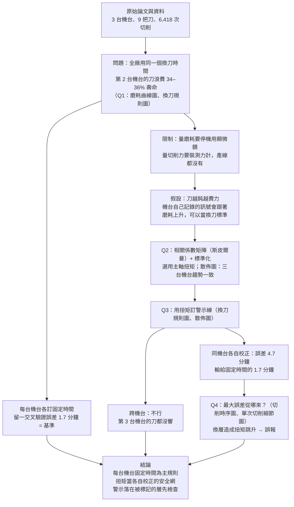

# 05 Demo 講稿（Q1–Q4 介面）

## 事前準備

確認畫面上方：Feature = **Spindle torque, mean |T|**、Norm. = **× own first 3–6 min**、VB limit = **140 µm**。

## 名詞對照（畫面上的標籤 → 講稿裡的說法）

| 畫面標籤 | 講稿裡的說法 |
|---|---|
| M1 / M2 / M3 | 第 1 / 2 / 3 台機台（DMG Mori Milltap 700 / HSC 30 linear / HSC 55 linear） |
| E1–E9 | 刀具編號：E1–E3 在第 1 台、E4–E6 在第 2 台、E7–E9 在第 3 台。E1 = 第 1 台機台的第一把刀 |
| V1 | 磨耗曲線圖 |
| V2 | 換刀規則圖（上方是計分板） |
| V3 | 相關係數矩陣 |
| V4 | 扭矩對磨耗散佈圖 |
| V5 | 切削時序圖 |
| V6 | 單次切削細節圖 |
| run | 一次切削 |
| J / R | 層間跳動 / 層內上升 |
| leave-one-out (LOO) | 留一交叉驗證（Leave-One-Out Cross-Validation） |

## 故事結構（邏輯圖）

---

## 0:00–0:40 開場：問題、使用者、資料
- **操作**：停在 Q1 畫面。滑鼠依序指：左上「WearLens」→ 上方 Q1–Q4 分頁 → 右上 Feature 和 VB limit → 右上 中 / EN。
- **畫面重點**：介面分成四個問題分頁。每個問題的主視圖放大在中間，其他視圖縮在左邊，右邊固定是計分板和結論框。

**中文**：在加工產線上，刀具會隨使用磨耗，影響加工品質，所以工廠通常用固定時間換刀。要知道刀實際磨到什麼程度，得停機用顯微鏡量；要量切削力，得裝昂貴的測力計，這兩種都不會出現在一般產線上。WearLens 的使用者是要在多台機台導入刀具監控的製程工程師。導入前，他們會先做試驗：在每台機台把刀用到壽命結束，用顯微鏡量磨耗，同時記錄機台訊號。我們用的就是這種公開試驗資料：三台機台、九把刀、6,418 次切削。我們的問題是：**不用測力計，只靠機台本身記錄的訊號，能不能判斷什麼時候該換刀？**上面四個分頁，就是把這個問題拆成四步。

**English**: In production, cutting tools wear with use and wear affects part quality, so plants usually replace tools after a fixed time. Measuring the actual wear means stopping the machine and using a microscope; measuring cutting force needs an expensive dynamometer. Neither is installed on a normal production line. WearLens is for process engineers who introduce tool monitoring on several machines. Before deployment they run trials: tools are worn out on each machine, wear is measured with a microscope, and machine signals are recorded. We use such an open trial dataset: three machines, nine end mills and 6,418 cuts. Our question: **without a dynamometer, can the signals the machine already records tell when to replace the tool?** The four tabs break this question into four steps.

## 0:40–1:35 Q1：全廠用同一個換刀時間好嗎？
- **操作**：
  1. 點上方分頁 **Q1**。
  2. 指中間 **V1**：三列從上到下分別是 M1、M2、M3，再指虛線（VB 140 µm）。
  3. 指右邊 **V2**：規則停在 **fixed · all**（固定 · 全廠），指 M2 三條的淺色段「unused 34–36 %」。
  4. ⊕ 拖曳 V2 上的黑色虛線往右，出現斜線段（超過門檻），再按 **Reset**。
  5. 點 V2 的規則按鈕 **per machine · LOO**（每台 · 留一交叉驗證），指 V2 底下的摘要「mean |error| 1.7 min · 3 overrun(s)」。
  6. 指計分板裡的虛線 **baseline**，再指右下的**結論框**。
- **畫面重點**：V1 同一列的三把刀幾乎重疊，M2 中段特別平。V2 的長條從 0 開始：深色是用掉的壽命、淺色是浪費的壽命、斜線是超過門檻。

**中文**：先看最基本的做法：固定時間換刀。中間是九把刀的磨耗曲線，一列是一台機台。第 2 台機台的曲線中段比較平，要 83 分鐘才磨到門檻，另外兩台大約 54 到 56 分鐘；同一台機台的三把刀則幾乎重疊。要注意，第 2 台機台的刀來自另一個批次，所以這個差異分不出是機台還是刀的關係。右邊的換刀規則圖，每把刀一條長條。全廠用同一個時間 53.5 分鐘的話，第 2 台機台的每把刀會浪費 34 到 36% 的壽命。那改成每台機台各訂一個時間；但如果用同一批刀訂時間、又用同一批刀評分，等於先看答案再考試，會太樂觀。所以我們用留一交叉驗證：每次拿一把刀出來當測試，只用同一台機台另外兩把刀來訂時間，再看這把刀實際差多少，三把刀輪流做。結果平均誤差 1.7 分鐘，3 次超過門檻、最多 2 分鐘，沒有漏報。這是計分板上的虛線基準，後面的訊號規則都跟它比。

**English**: We start with the basic practice, a fixed replacement time. In the centre are the wear curves of the nine end mills, one row per machine. Machine 2's middle phase is flatter, so it reaches the limit after 83 minutes instead of 54 to 56, while the three end mills on one machine almost overlap. Note that machine 2's end mills come from another batch, so machine and batch cannot be separated. On the right, the replacement-rule chart shows one bar per end mill. With one time for all machines, 53.5 minutes, every end mill on machine 2 wastes 34 to 36 percent of its life. We then set one time per machine. Setting and scoring it on the same tools would be like seeing the answers before the exam, so we use leave-one-out cross-validation: each end mill in turn is held out as the test, the time is set from the other two on its machine, and we check how far off it is. Mean error 1.7 minutes, three overruns of at most 2 minutes, no miss. This is the dashed baseline in the scoreboard that the signal rules are compared with.

## 1:35–2:45 Q2：扭矩會跟著磨耗上升嗎？
- **操作**：
  1. 點上方分頁 **Q2**。中間變成 V3 和 V4，V1 縮到左邊。
  2. 在 **V3** 把滑鼠停在「Spindle torque, mean |T|」那列的 **E1** 格子上，tooltip 顯示 ρ；再停在同一列最右邊的 **All** 格子上（0.95）。
  3. 上方 **Norm.**（正規化）下拉選單改成 **raw**（原始值），V3 的列會用動畫重新排序；停在 Spindle torque 的 All 格子上（0.57），再指 **V4**：三種顏色分成上下不同高度。再改回 **× own first 3–6 min**，指 V4 三色疊在一起。
  4. 停在 V3 下方灰底區的「Force X, mean」All 格子上（0.98）。
  5. 指 **V4**：三種顏色都往右上升，再指灰色帶和上方標籤「at VB 140 µm: 1.24 – 1.37 (9 tools)」。
  6. 指右下的**結論框**。
- **畫面重點**：V3 每列是一個特徵、每欄是一把刀，顏色是 ρ（藍－灰－紅，0 為中點），預設依「最差那把刀的 ρ」排序。測力計那組是灰底，表示只作參考。

**中文**：接下來檢驗假設：刀越鈍，維持同樣轉速和進給需要越大的力，所以機台的主軸扭矩應該跟著磨耗上升。中間的矩陣列出 21 個訊號特徵和磨耗的相關程度，一格是一把刀；上半部是機台本身就有的 8 個訊號，下半部灰底是測力計，只當參考。這裡用的是斯皮爾曼等級相關係數：它只看排名，問的是「磨耗越大，訊號是不是也越大」，不要求兩者成直線關係，也比較不受極端值影響。扭矩和磨耗的關係不是一條直線，例如第 2 台機台在磨耗 40 微米以前幾乎不升、之後才變陡，所以用只看排名的斯皮爾曼比較適合。主軸扭矩在每一把刀都有 0.97 以上，九把刀合起來是 0.95，接近測力計橫向力的 0.98。但如果直接用原始扭矩，九把合起來只剩 0.57。原因是三台機台的扭矩起點不一樣：剛磨合完的刀，第 1 台大約 1.22 牛頓米、第 2 台 1.35、第 3 台只有 1.03；快磨壞時分別是 1.58、1.77 和 1.27。每台機台自己都是越磨越大，但第 3 台快磨壞的刀，扭矩還比第 2 台的新刀低。如果訂「扭矩到 1.5 就換刀」，第 3 台永遠不會觸發。起點不同是機台本身的差異，例如主軸馬達大小、驅動方式，跟磨耗無關。所以我們做標準化：每把刀取它自己前 3 到 6 分鐘扭矩的中位數當基準，之後每次切削都除以這個基準，單位就從牛頓米變成「是新刀時的幾倍」。這樣就把機台的起點差異消掉，只留下「這把刀從新到現在升了多少」，三台機台的曲線也大致疊在一起，九把合起來的相關從 0.57 升到 0.95。這只用到新刀剛開始的資料，產線上每換一把新刀就能算，不需要顯微鏡。疊在一起的好處是，可以試著用同一條警示線，例如升到 1.3 倍就換刀，去管所有機台的刀；這條線能不能真的跨機台用，是下一步要測的。右邊的散佈圖，橫軸是磨耗、縱軸是標準化後的扭矩：三台機台都往上升，磨到門檻時大約是新刀的 1.24 到 1.37 倍。所以後面我們選用主軸扭矩當指標。機台訊號裡，表現最好的是主軸扭矩和 Y 軸進給出力，每一把刀都在 0.97 左右；但九把刀合起來，主軸扭矩比較高，而且三台機台的主軸扭矩單位相同，進給出力在第 1 台是扭矩、另外兩台是推力，單位不同。主軸扭矩的物理意義也最直接，就是刀越鈍越費力。扭矩看得到磨耗趨勢；但相關高只代表趨勢一致，還不代表能決定什麼時候換刀。

**English**: Next we test the hypothesis: a worn tool needs more force to keep the same speed and feed, so the machine's spindle torque should rise with wear. The matrix in the centre shows how strongly each of 21 signal features follows wear, one cell per end mill; the upper part holds the 8 signals the machine already records, and the grey lower part the dynamometer, as a reference only. We use Spearman's rank correlation: it only compares rankings, asking whether more wear comes with a larger signal, without assuming a straight-line relation, and it is less affected by outliers. Torque does not rise with wear along a straight line; on machine 2, for example, it barely rises below 40 micrometres of wear and then steepens, so a rank-based measure suits it better. Spindle torque exceeds 0.97 for every end mill and reaches 0.95 with all nine pooled, close to the dynamometer's lateral force at 0.98. With raw torque the pooled value drops to 0.57, because the machines start at different levels: after break-in, torque is about 1.22 newton-metres on machine 1, 1.35 on machine 2 and only 1.03 on machine 3; near the end of life it is 1.58, 1.77 and 1.27. Each machine rises with wear, but a nearly worn tool on machine 3 still has less torque than a new one on machine 2, so a rule like "replace at 1.5" would never fire on machine 3. The different starting levels come from the machines themselves, such as spindle motor size and drive type, not from wear. We therefore normalize: each end mill's median torque over its first 3 to 6 minutes becomes its baseline, and every later cut is divided by it, so the unit changes from newton-metres to "times the new-tool level". This removes the machine offset and keeps only how much the tool has risen since it was new; the curves of the three machines roughly overlap, and the pooled correlation rises from 0.57 to 0.95. It needs only the start of each new tool, so it works in production without a microscope. Overlapping curves mean one alarm level, say 1.3 times, could in principle serve all machines; whether it really transfers is the next test. In the scatter plot on the right, wear is on the x-axis and normalized torque on the y-axis: all three machines rise and reach 1.24 to 1.37 times the new-tool level at the limit. We therefore use spindle torque as the indicator from here on. Among the machine signals, spindle torque and the Y feed-axis effort perform best, around 0.97 for every end mill; but pooled over all nine, spindle torque is higher, and it has the same unit on all three machines, whereas the feed-axis effort is a torque on machine 1 and a force on the other two. Its meaning is also the most direct: a worn tool needs more force. Torque shows the wear trend; but a high correlation only shows a shared trend, not when to replace the tool.

## 2:45–3:25 Q3：能用訊號設定警報嗎？
- **操作**：
  1. 點上方分頁 **Q3**。V2 會自動切到 **signal alarm**，校正方式是 **calibrated on the other machines**（用其他機台校正）。
  2. 指 **V2**：M1、M2 的 ▼ 警示都在長條末端之前，標「… min early」；M3 三列寫「no alarm」。
  3. 指中間 **V4** 的灰色帶：M3 的綠色點線在 VB 140 µm 處比較低。
  4. 點計分板的 **Signal · same machine**（訊號 · 同機台（留一））那列。V2 的校正會切到 leave-one-out，指它的長條（4.7 min）和 baseline 虛線（1.7 min）的距離。
  5. 指右下的**結論框**。
- **畫面重點**：計分板四條規則用同一個測試比平均誤差，長條都從 0 開始，漏報用文字另外列出。

**中文**：換刀需要一條警示線：標準化後的扭矩超過多少就換。我們先用兩台機台訂警示線，拿到第三台測試。結果第 1、2 台機台提早 6 到 15 分鐘警示，第 3 台機台的三把刀完全沒響。散佈圖可以看到原因：磨到門檻時，第 3 台的扭矩倍數比較低，用另外兩台訂的線，它碰不到。所以趨勢可以跨機台，警示線不行。改成每台機台各自校正，一樣用留一交叉驗證測試：平均誤差 4.7 分鐘，一次晚報、一次漏報，比固定時間的 1.7 分鐘差。原因是同一台機台的刀壽命本來就很一致，固定時間已經很準。

**English**: A replacement needs an alarm level: replace when normalized torque exceeds it. We set the level on two machines and test it on the third. Machines 1 and 2 alarm 6 to 15 minutes early, and the three end mills on machine 3 never alarm. The scatter plot shows why: at the limit, machine 3's torque ratio is lower, so a level set on the other two machines is never reached. The trend transfers between machines; the alarm level does not. Calibrated per machine and tested with the same leave-one-out cross-validation, the mean error is 4.7 minutes with one late and one missed alarm, worse than 1.7 minutes for the fixed time, because tool lives on one machine are already very similar.

## 3:25–4:25 Q4：這個跳升真的是磨耗嗎？
- **操作**：
  1. 點上方分頁 **Q4**（會自動選 E1）。中間變成 V5 和 V6。
  2. 指 **V5**：第 15 層上方的洋紅色 **J** 標記、▼ 標籤「alarm: run 443, VB 103 µm」，以及標記層數「Flagged layers: 2 of 222」。
  3. 在 V5 第 14 層（J 左邊那一段）把滑鼠移到 tooltip 顯示 **run 420** 左右，點下去，再點 V6 的 **pin as comparison**（釘選比較）。
  4. 在 J 底下第 15 層點 **run 443**（停在 tooltip 顯示 run 443 再點）。
  5. 指 **V6**：彩色線（第 15 層）的 spindle torque 和 |Fxy| reference 都比灰色線（第 14 層）高，feed axis 幾乎一樣。
  6. 回到 V5，指第 16 層扭矩掉回來。
  7. ⊕ 在 V2 的 persistence 輸入框（「runs. Level:」左邊）輸入 **30** 按 Enter：E1 變成「0.5 min early · VB 137」。再點 **same machine incl. itself (in-sample)**，計分板和摘要出現 **5 missed**。把輸入框改回 **1**，校正點回 **calibrated on the other machines**。
  8. 指右下的**結論框**。
- **畫面重點**：V5 的橫軸是第幾次切削；淡色帶是層；洋紅色只用在警示、標記和選取。V6 不同單位分成上下面板，共用時間軸，沒有雙 y 軸。

**中文**：簡單說，這一段要回答的是：扭矩上升，不一定都是因為磨耗。前面的假設在趨勢上成立，但扭矩也可能因為別的原因跳升，這時候警示就會誤報。最大的警示誤差發生在第 1 台機台的第一把刀，提早 12.3 分鐘，我們追查原因。中間上方是這把刀每一次切削的扭矩，淡色帶代表工件的一層，刀每切 1 到 2 層就會被拆下來量磨耗。第 15 層整層跳高 19%，系統標成層間跳動，警示就在這裡響；全部 222 層只有 2 層被標記。我把第 14 層的一次切削釘住當對照，再點第 15 層的一次切削。下方的細節圖裡，主軸扭矩和測力計整段都變高，進給軸幾乎沒變；兩套獨立量測一起變，不太像感測器故障。但第 16 層扭矩又回落，磨耗不會倒退，所以這也不是磨耗，可能是重新裝刀後加工狀態改變。⊕ 如果要求扭矩持續超標 30 次切削才發警示，這把刀只會提早 0.5 分鐘；但同樣的設定在用同一台機台、包含這把刀自己來校正時，九把刀有五把漏報，所以這是誤報和漏報之間的取捨。判斷這種事件要看兩套訊號和層的結構，所以我們的規則是：警示落在被標記的層，先檢查刀，不直接換刀。

**English**: In short, this step shows that a torque rise is not always wear. The hypothesis holds for the trend, but torque can also jump for other reasons, and then the alarm is false. The largest alarm error is on the first end mill of machine 1, 12.3 minutes early, so we trace its cause. At the top is this end mill's torque cut by cut; bands are layers of the workpiece, and the tool is removed for measurement every one or two layers. Layer 15 jumps by 19 percent and is flagged as a layer jump, exactly where the alarm fires; only 2 of 222 layers are flagged. I pin a cut from layer 14 as a reference and open a cut from layer 15. In the detail view below, spindle torque and dynamometer force are higher over the whole cut, while the feed axis barely changes. Two independent measurement chains agree, so a sensor fault is unlikely. But torque falls back in layer 16, and wear never goes back, so it is not wear either; the setup may have changed after re-clamping. ⊕ Requiring torque to stay above the level for 30 cuts moves this alarm to 0.5 minutes early, but when the level is calibrated on the same machine including the tested end mill, the same setting leaves five of nine end mills without an alarm, so it trades false alarms against missed ones. Judging such an event needs both signal chains and the layer structure, so our rule is: an alarm in a flagged layer triggers an inspection, not a replacement.

## ⊕ 4:25–4:40 連動展示
- **操作**：
  1. 點上方分頁 **ALL**（全部視圖）。
  2. 在 **V1** 任一張小圖上水平拖曳，選 20–50 分鐘：V3 的 ρ 重算、列用動畫重排，V4 範圍外的點變淡。在 V1 空白處點一下取消。
  3. 在 **V4** 拖一個框：V1 和 V5 會標出被框選的 run。
  4. 按 **Reset**。
- **畫面重點**：三個視圖的橫軸刻意不同（時間、VB、第幾次切削），是同一群 run 的三個角度，靠高亮串起來。

**中文**：最後展示視圖之間的連動。在磨耗曲線上選一段時間，相關係數矩陣會即時重算、列跟著重排，散佈圖只留下這段的點；在散佈圖框一群點，磨耗曲線和切削時序圖會同步標出來。三張圖的橫軸分別是時間、磨耗和切削次序，是同一群資料的三個角度。

**English**: Finally, the views are linked. Brushing a time range on the wear curves recomputes the correlation matrix and re-sorts its rows, and the scatter plot fades the other cuts; brushing in the scatter plot highlights the same cuts on the wear curves and the run timeline. The three views use time, wear and cut order as x-axes: three angles on the same data.

## 4:40–5:00 總結
- **操作**：點回 **Q3**，讓計分板四條長條和結論框一起出現在畫面上。

**中文**：回到開場的問題，三個結論。第一，在這組資料裡，每台機台各訂固定時間最準，誤差 1.7 分鐘。第二，主軸扭矩看得到磨耗趨勢，但警示線不能跨機台，同機台校正也只有 4.7 分鐘，所以只適合當安全網。第三，最大的誤差來自換層事件，警示落在被標記的層就先檢查。限制是每台只有 3 把刀、切削條件固定、磨耗多半是內插值；條件會變的產線，結果可能不同。謝謝，這是 WearLens。

**English**: Back to our question, three takeaways. First, in this dataset a fixed time per machine is the most accurate rule, with an error of 1.7 minutes. Second, spindle torque shows the wear trend, but its alarm level does not transfer between machines, and per-machine calibration reaches only 4.7 minutes, so it suits a safety net. Third, the largest error comes from a layer event; an alarm in a flagged layer triggers an inspection first. Limitations: three end mills per machine, constant cutting conditions and mostly interpolated wear; on lines where conditions vary, the result may differ. Thank you, this was WearLens.

---

## 預想問題（依評分項目整理）

| 評分項目 | 可能的問題 | 回答重點 |
|---|---|---|
| C1 | 這些使用者真的會有這份資料嗎？ | 導入監控前本來就要做試驗：顯微鏡量磨耗、機台記錄訊號；測力計只在試驗時加裝。這份資料就是這種試驗。 |
| C1 | 為什麼不用一個查詢或一張靜態圖？ | 結果由特徵、正規化、校正方式、警示線、延續條件、VB 門檻 6 個參數一起決定，每改一個，早報、晚報、漏報會一起變，需要即時看結果才能取捨。 |
| C1 | 為什麼不用自動演算法？ | 只有 9 把刀，一個事件（E1）就決定設定看起來好不好；要判斷事件是感測器故障、製程改變還是磨耗，得比對兩套訊號，這是領域判斷，不是可以最佳化的目標。早報和漏報之間的取捨也牽涉成本。 |
| C1 | 新穎性？ | 資料是第一份公開的多機台刀具壽命資料，課程作業沒有用過；計分板用同一個留一法測試比較兩類規則，是我們自己的設計。 |
| C2 | 任務可以在系統裡測試嗎？ | 每個任務都有明確的視圖、操作和輸出，例如 T7 的輸出就是計分板上的 MAE 和漏報數。 |
| C3 | 每個視圖都有任務嗎？ | 見報告的 Task–design 表：V1→T1、T2；V2→T2、T6、T7；V3→T3；V4→T4、T7；V5→T5、T6；V6→T6。 |
| C4 | 為什麼 V3 用矩陣，不用一欄排名？ | 一欄排名看不到機台差異，例如 Tooth-pass 在 M3 是負相關；色階藍－灰－紅以 0 為中點，飽和度降低，數值 hover 才顯示。 |
| C4 | V4 有 6,418 個點，不會重疊嗎？ | 降低透明度，再加每把刀的滑動中位數線；考慮過 hexbin，但會失去機台身分。 |
| C4 | 顏色怎麼選？ | 顏色只代表 3 台機台，已用色盲模擬驗證（ΔE ≥ 8.5）；9 把刀不用 9 種顏色，用位置和文字區分；只有一個強調色給警示和選取。 |
| C4 | V6 為什麼不用雙 y 軸？ | 雙軸的比例可以任意調，容易誤導；不同單位分成上下面板、共用時間軸。 |
| C5 | 縮圖不能操作，這樣算連動嗎？ | 縮圖就是真的視圖縮小，每次選取都會同步更新；要操作就切到用它的問題，或用 ALL 分頁看全部放大的視圖。 |
| C5 | 轉場動畫有什麼用？ | 只用在 V3 換正規化或時間範圍時的列重排，讓使用者追得到同一個特徵的位置。 |
| C6 | 分析元件怎麼幫助形成假設？ | A2 先提出「扭矩跟著磨耗」，A3 用同一個留一法測試能不能換刀，A4 再找出誤差來源；參數都能即時改、立即驗證。 |
| C6 | 留一交叉驗證是什麼？為什麼要用？ | 機器學習常用的驗證方法（Leave-One-Out Cross-Validation）。每次留一把刀當測試，只用同機台另外兩把訂規則，三把輪流。這樣每把刀都是「沒看過的新刀」，模擬實際導入；用同一批刀訂規則又評分會太樂觀。 |
| C6 | 為什麼用斯皮爾曼相關，不用皮爾森？ | 斯皮爾曼只看排名，只要求「磨耗越大、訊號越大」，不要求直線關係，也比較不受極端值影響；扭矩和磨耗的關係不是直線（例如第 2 台在磨耗 40 µm 前幾乎不升）。 |
| C6 | 為什麼要標準化？怎麼做？ | 三台機台的訊號起點不同（新刀扭矩約 1.0–1.35 Nm），直接混在一起合併 ρ 只有 0.57。每把刀除以自己前 3–6 分鐘的中位數，變成「新刀的幾倍」，合併 ρ 升到 0.95。 |
| C6 | 為什麼放這麼多特徵？ | 21 個特徵（8 個機台訊號、13 個測力計）是讓工程師自己比較、篩選候選，而不是我們先挑好答案；也看得出有些特徵不能用，例如刀齒頻率振幅在第 3 台機台是反向。測力計只作參考，矩陣預設只顯示 2 個代表。 |
| C7 | Insight 會不會是編出來的？ | 所有數字都由 `scripts/verify.py` 重算，介面顯示的值由 `scripts/verify_app.js` 自動核對；結論框的文字是即時從分析結果產生的。 |
| C7 | 結論是固定時間比較好，那 VA 的價值在哪？ | VA 讓我們發現「趨勢對但警示線不能跨機台」、「最大誤差是換層事件」，這兩點看單一相關係數或單一張圖都看不出來；工程師因此知道訊號該怎麼用（每台校正、當安全網）。 |
| 資料 | 為什麼門檻是 140，不是 150？ | 作者定 150 µm，但 M2 三把刀最大只到 147–149 µm，用 150 會沒有壽命終點；介面上可以調。 |
| 資料 | 新刀沒有完整壽命，怎麼正規化？ | 用自己前 3–6 分鐘的中位數，不需要顯微鏡也不用未來的資料；滑動中位數也只看過去 15 個 run。 |
| 限制 | 這個結論能推廣嗎？ | 不能直接推廣：每台只有 3 把刀、單一刀具和切削參數；條件會變的產線，固定時間會變差，訊號監控的價值會更高。 |
| 技術 | 有沒有後端？能離線跑嗎？ | 沒有後端或資料庫；Python 離線前處理成 9.6 MB 的檔案，瀏覽器直接讀，D3 放在本機 `lib/`，不需要網路。 |
| 結論 | 說固定時間浪費，結論卻推固定時間？ | 浪費來自「全廠同一個時間」；每台機台各訂時間，平均浪費從 34–36% 降到約 2%。 |
| 結論 | 依機台訂時間，可能其實是批次的影響？ | 同意，分不開；但結論只需要「同機台的刀壽命一致」，與原因無關。M1、M3 同批次也成立。 |
| 結論 | 為什麼固定時間這麼準？ | 同機台、同批次、同切削條件，三把刀到門檻最多差 3.4 分鐘；條件會變時固定時間就不準。 |
| 結論 | 為什麼警示線不能跨機台？ | V4：VB 140 時 M3 的扭矩倍數較低；可能是驅動方式（滾珠螺桿 vs 線性馬達）或批次，資料分不開。 |
| 結論 | E1 以外的提早警示呢？ | 都不在被標記的層，是警示值本身不準；排除 E1 後留一法誤差仍 3.6 分鐘，高於 1.7。 |
| 結論 | 0.95 的相關不就夠了？ | 相關高只代表趨勢一致；用其他機台校正的測試誤差 6–15 分鐘、M3 全漏報。 |
| 結論 | 有沒有直接證明「越鈍越費力」？ | V4 九把刀都上升、門檻時 1.24–1.37 倍；V6 釘住新刀 run 對照鈍刀 run，扭矩整段變高。 |
| 結論 | 只有機台訊號看得出 E9 的鋸齒嗎？ | 扭矩每層升 5–7%，和 VB 100–140 間的訊號差（約 0.06–0.09 倍）相當，會影響警示。 |
| 結論 | MAE 怎麼處理漏報？ | 只算有警示的刀，漏報另外列出；摘要同時顯示早、晚、漏報數量。 |

---

## 評分項目對照（講到哪一段，就在回答哪一題）

講稿本身不念評分項目和任務編號；下表供準備和口試時對照。

| 評分項目 | 在哪一段回答 | 一句話重點 |
|---|---|---|
| 邏輯鏈 Data → Users、C1 | 開場 | 多機台試驗資料就是導入監控的工程師手上會有的資料 |
| Users → Challenges、C1 為什麼要 VA | 開場、Q4 結尾 | 規則有 6 個參數會一起影響結果；一個事件到底是不是磨耗，要靠人判斷 |
| Challenges → Tasks、C2 | 各段（任務編號見報告 Table 2） | Q1 → T1、T2；Q2 → T3、T4；Q3 → T7；Q4 → T5、T6 |
| Tasks → Design、C3、C4 | 每段的「畫面重點」 | 每個任務都有對應的視圖和互動；編碼的理由在預想問題裡 |
| C5 連動、總覽→篩選→細節 | Q2 的排序動畫、Q4 的點選、⊕ 連動段 | 縮圖會同步更新；V1 刷選會重算 V3；點 run 會在 V6 開啟細節 |
| C6 分析元件 | Q1–Q4 | A1 正規化、A2 ρ 排名、A3 規則評估、A4 層級診斷，參數都能即時調整 |
| C7 Insight 回到挑戰 | 每段結尾的結論框、總結 | 三個結論分別回答 CH1–CH3，也回答了開場的假設 |
| C8 | 整場 | 系統名稱 WearLens 出現在開場和結尾 |
